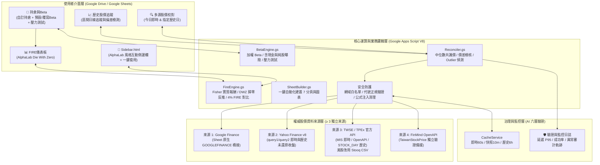

# Die With Zero × Portfolio Beta × 多源股價校對系統 — 系統架構設計書

## 1. 專案目標與 Google Drive 最佳檔案型態選型

本專案目標為建置一套可於 **Google Drive** 原生運作之完整財富自由與風險管理系統，同時滿足三大核心需求：
1. **100% 對齊 [AlphaLab `alphalab.site/fire`](https://www.alphalab.site/fire) 的 Die With Zero（死前財產歸零）計算機設計**。
2. **使用者自訂股票持倉與整體投資組合 Beta 計算**（內建 `0050=1`、`006208=1`、`00662=1`、`00685L=2`、`00631L=2`、`CASH=0`，並支援任意台股/美股與自訂 Beta 覆寫）。
3. **三源以上權威股價校對引擎**，同時支援 **今日目前股價 (Live/Today)** 與 **歷史收盤價追蹤 (Historical Close)**。

### 為何選擇「Google 試算表 + 綁定式 Google Apps Script + 互動側邊欄」？

| 候選方案 | `=GOOGLEFINANCE()` 原生支援 | 自由編輯持倉與公式即時連動 | 多源外部 API 抓取與校對 | 互動式 AlphaLab UI | 綜合評分 |
| :--- | :---: | :---: | :---: | :---: | :---: |
| 純 Google 文件 (Docs) | ❌ | ❌ | ❌ | ❌ | 不適用 |
| 純 Google 表單 (Forms) | ❌ | ⚠️ 僅單向提交 | ❌ | ❌ | 不適用 |
| 獨立 Apps Script Web App | ❌（GAS 無法直呼 `GOOGLEFINANCE`） | ⚠️ 需外接資料庫 | ✅ | ✅ | 次佳 |
| **Google Sheets + Bound GAS + HTML Sidebar（採用方案）** | **✅ 原生支援** | **✅ 零延遲公式連動** | **✅ 4+ 權威來源** | **✅ 還原 AlphaLab 體驗** | **🏆 最佳** |

---

## 2. 系統整體架構圖

---

## 3. 工作簿 7 大分頁規格（100% 欄位設計）

| 編號 | 分頁名稱 | 角色與核心內容 |
| :---: | :--- | :--- |
| 1 | `📊 FIRE儀表板` | 完整還原 `alphalab.site/fire`：「關於你（還在工作/已經退休、年齡、預期退休年齡、預計壽命）」、「資產與收支（支援自動連動持倉總市值或手動模式）」、「進階假設（名目報酬、通膨、Fisher 實質報酬、4% FIRE、Beta CAPM 參考）」、核心 KPI 卡片（DWZ 退休數字、今日退休門檻、最高可花月開銷、DWZ vs 4% FIRE 最早退休年齡對比、資產耗盡警示）與原生資產走勢折線圖。 |
| 2 | `💼 持倉與Beta` | 使用者自由輸入持倉（預載 `0050`、`006208`、`00662`、`00685L`、`00631L`、`CASH` 並保留多列空白模板列支援任意台/美股），自動轉換匯率 (`USDTWD`)、自動帶入校對後共識股價、自動查表預設 Beta 並支援自訂覆寫 Beta、計算含現金整體 Beta、純股票 Beta、等效大盤曝險金額與大盤崩盤壓力測試表。 |
| 3 | `🔍 多源股價校對` | 上半部「今日 / 目前股價四源校對矩陣」，下半部「指定歷史日期收盤價四源校對矩陣」。每個標的並列 Google Finance、Yahoo Finance、TWSE/TPEx（或 Stooq）、FinMind 四大來源報價，計算有效來源數、中位數共識價、最大價差率、狀態燈號與離群來源（Outlier）。 |
| 4 | `📈 歷史股價追蹤` | 支援使用者指定股票代號（或全持倉）與起訖日期，批次拉取多日歷史收盤價並逐日進行三源以上比對，輸出完整歷史時間序列與異常日標記。 |
| 5 | `⚙️ 預設Beta與參數` | 可維護之預設 Beta 查表區（含 6 個必填預設值）、台灣內政部簡易生命表參考對照、多源校對容差參數（今日/歷史門檻）、CAPM 參考參數（無風險利率與市場風險溢酬）。 |
| 6 | `📉 逐年資產模擬` | 從現今年齡至預期壽命之逐年現金流與資產軌跡表：期初資產、實質投資收益、年度儲蓄/提領、實際 DWZ 期末資產、理想歸零參考軌跡、該歲立即退休所需 DWZ 本金、傳統 4% FIRE 目標線、名目資產（含通膨）。 |
| 7 | `🛡️ 驗證與監控日誌` | 對應 AI 六層驗證第 5 與第 6 層：自動記錄每次 API 呼叫耗時 (ms)、來源成功/失敗狀態、P95 延遲統計、校對共識達成率及使用者操作效益追蹤指標。 |

---

## 4. 核心數學模型規格

### 4.1 Fisher 實質報酬率（今日幣值換算）
$$r_{\text{real}} = \frac{1 + r_{\text{nominal}}}{1 + i} - 1$$
所有輸出均以**今日實際購買力（Real Terms）**呈現，避免名目通膨失真。

### 4.2 逐年資產遞推與 Die With Zero 歸零條件
- **工作累積期**（$\text{age} < \text{retireAge}$）：
  $$W_{t+1} = W_t (1 + r_{\text{real}}) + S_{\text{annual}}$$
- **退休提領期**（$\text{age} \ge \text{retireAge}$）：
  $$W_{t+1} = W_t (1 + r_{\text{real}}) - \max(0, C_{\text{annual}} - P_t)$$
  其中 $P_t$ 為選填退休金/被動收入（預設為 0，與 AlphaLab 原版保守假設一致）。

### 4.3 Die With Zero 退休目標金額與最高月開銷反推
設退休期長 $N = \text{lifeExpectancy} - \text{retireAge}$：
- **年金現值因子**：
  $$A(r, N) = \begin{cases} N, & |r| < 10^{-9} \\ \dfrac{1 - (1+r)^{-N}}{r}, & \text{otherwise} \end{cases}$$
- **DWZ 目標資產（退休當下）**：
  $$\text{DWZ Target} = \sum_{k=1}^{N} \frac{\max(0, C_{\text{annual}} - P_k)}{(1 + r_{\text{real}})^k}$$
- **反推每月最高可花金額**（使預期壽命終點結餘精準 $= 0$）：
  $$C_{\max,\text{monthly}} = \frac{W_{\text{ret}} + \text{PV}(P)}{12 \cdot A(r_{\text{real}}, N)}$$

### 4.4 整體投資組合 Beta 計算
$$\beta_{\text{portfolio}} = \frac{\sum_{i=1}^{n} V_i \cdot \beta_i}{\sum_{i=1}^{n} V_i} = \sum_{i=1}^{n} w_i \cdot \beta_i$$
- $V_i = \text{Shares}_i \times \text{Price}_i \times \text{FX}_i$（現金 $V_{\text{cash}} = \text{Amount}, \beta_{\text{cash}} = 0$）。
- 等效大盤曝險金額：$\text{Exposure} = \sum_{i=1}^{n} V_i \cdot \beta_i = V_{\text{total}} \cdot \beta_{\text{portfolio}}$。

### 4.5 三源以上股價共識與離群偵測演算法
1. 僅採納大於 0 且非 `NaN` 的有限數值，**歷史收盤價統一採「未還原收盤價 (Unadjusted Close)」**以對齊 TWSE 官方成交資訊，避免除權息日產生誤報價差。
2. 共識價採**中位數（Median）**以抵抗單一異常來源（Outlier）。
3. 價差率：$\text{Spread\%} = \frac{\max(P) - \min(P)}{\text{Median}(P)}$。
4. 狀態分類：
   - **歷史收盤**：有效來源 $\ge 3$ 且 ($\text{Spread\%} \le 0.1\%$ 或 $\max - \min \le 0.05$) $\rightarrow$ `VERIFIED`；$\le 1.0\%$ $\rightarrow$ `MINOR_DIFF`；$> 1.0\%$ $\rightarrow$ `DISCREPANCY`。
   - **今日即時**：有效來源 $\ge 3$ 且 $\text{Spread\%} \le 0.5\%$ $\rightarrow$ `VERIFIED`；$\le 2.0\%$ $\rightarrow$ `DELAY_DIFF`；$> 2.0\%$ $\rightarrow$ `DISCREPANCY`。
   - 有效來源 $< 3$ $\rightarrow$ `INSUFFICIENT_SOURCES`（強制警示未達三源門檻）。

---

## 5. 安全與治理設計（對齊 AI 六層驗證第 4 層）

1. **最小權限 OAuth Scopes**：僅申請 `spreadsheets.currentonly`、`script.external_request`、`script.container.ui`，不要求全 Drive 讀寫權限。
2. **網域白名單（SSRF 防護）**：所有 `UrlFetchApp` 請求強制經過 `validateAllowedUrl()` 檢查，僅允許 `query1.finance.yahoo.com`、`query2.finance.yahoo.com`、`www.twse.com.tw`、`openapi.twse.com.tw`、`mis.twse.com.tw`、`www.tpex.org.tw`、`api.finmindtrade.com`、`stooq.com`。
3. **輸入驗證與公式注入防護（Formula Injection / CSV Injection）**：對所有外部回傳名稱或使用者輸入字串進行 `sanitizeSheetText()` 過濾，阻斷開頭為 `=`、`+`、`-`、`@`、`\t`、`\r` 的惡意公式載荷；股票代號須符合嚴格正規表示式 `^[A-Z0-9.\-]{1,12}$`。
4. **零硬編碼憑證**：選用之 FinMind Token 僅透過 `PropertiesService.getScriptProperties()` 儲存，絕不寫入程式碼或工作表。
5. **XSS 防護**：`Sidebar.html` 全程使用 `textContent` 與 DOM API，嚴禁將未跳脫字串注入 `innerHTML`。
