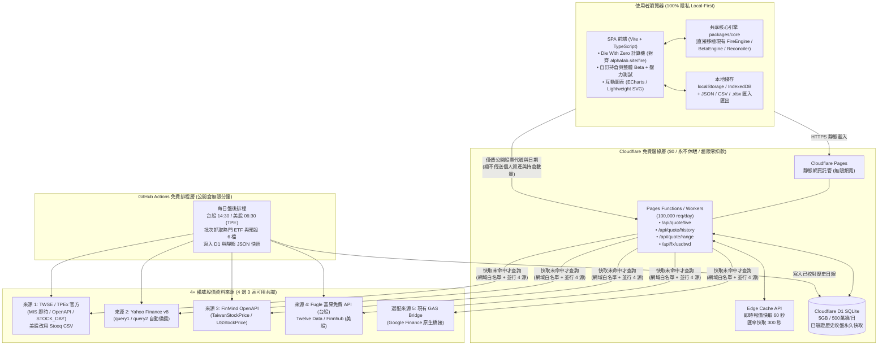

# 免費平台全功能網頁架構研究報告（先研究、不實作）

- **研究日期**：2026-11-27 (+08:00)
- **研究目標**：評估以 **$0 免費雲端平台**建置獨立網頁應用，**100% 重現目前 Google Drive 版所有功能**（對齊 [`alphalab.site/fire`](https://www.alphalab.site/fire) 的 Die With Zero 計算機 + 自訂持倉與整體 Beta 計算 + 三源以上今日/歷史股價校對與區間追蹤）。
- **範圍聲明**：本階段僅進行技術可行性、2026 免費平台額度對比、風險治理與架構設計，**尚未進入程式實作**。
- **對應網頁版報告**：[FREE_WEB_ARCHITECTURE_RESEARCH.html](./FREE_WEB_ARCHITECTURE_RESEARCH.html)

---

## 一、全功能遷移可行性與三大核心技術瓶頸

要將現有 Google Drive（試算表 + Apps Script）所有功能 100% 搬遷至免費網頁，核心運算完全可於瀏覽器端完成，真正的技術分水嶺在於**外部金融資料串接**：

| 現有功能模組 | 網頁端對應實作方式 | 能否複用現有引擎？ | 關鍵技術瓶頸 |
| :--- | :--- | :---: | :--- |
| **1. Die With Zero 計算機**（對齊 `alphalab.site/fire`） | 純前端 TypeScript / JS 即時計算 + 互動圖表（Canvas/SVG） | ✅ **100% 複用 `FireEngine.gs`** | 無瓶頸；純瀏覽器運算可達 60fps 滑桿體驗與 100% 財務隱私。 |
| **2. 自訂持倉與整體 Beta**（預設 6 檔 + 自訂覆寫 + 壓力測試） | 純前端狀態管理 + `localStorage` / `IndexedDB` + JSON/CSV 匯出入 | ✅ **100% 複用 `BetaEngine.gs`** | 跨裝置同步需求（可採 Local-First + 選配 Google Drive AppData / 匯出入）。 |
| **3. 今日/歷史三源以上股價校對與區間追蹤** | **必須透過免費 Serverless / Edge Proxy 後端** + 盤後快取層 | ✅ **100% 複用 `Reconciler.gs`** | **三大瓶頸**：① 瀏覽器 CORS 封鎖；② Google Finance 無公開 REST API；③ 雲端共享 IP 限流與免費 CPU 限制。 |

### 三大瓶頸深度拆解

1. **瓶頸一：瀏覽器 CORS 封鎖（為何純靜態網頁無法單獨完成）**
   - 瀏覽器同源政策會直接封鎖前端 `fetch()` 呼叫 Yahoo Finance (`query1.finance.yahoo.com`)、TWSE (`mis.twse.com.tw`、`www.twse.com.tw/rwd/...`)、TPEx 與 Stooq。
   - **結論**：單純使用 GitHub Pages 等純靜態託管**無法**做到即時多源股價抓取，必須搭配免費 Serverless / Edge API 層（如 Cloudflare Workers / Pages Functions）。

2. **瓶頸二：`=GOOGLEFINANCE()` 無公開官方 REST API**
   - Google Sheets 內的 `=GOOGLEFINANCE()` 屬於試算表專屬函式，Google 並未開放免費公開 REST API 給外部網頁直接呼叫（且硬爬網頁違反服務條款且易遇反爬蟲/CAPTCHA）。
   - **兩條合法、穩定的解決路徑**：
     - **路徑 A（純官方 API 四源方案 — 推薦主力）**：
       - **台股 4 源**：① **TWSE / TPEx 官方 API**（MIS + OpenAPI + `STOCK_DAY`）＋ ② **Yahoo Finance Chart API v8**（`query1`/`query2`）＋ ③ **FinMind OpenAPI**（免費 300–600 次/時）＋ ④ **Fugle 富果股市免費官方 API**（免費帳號 60 次/分即時 + 歷史行情）。
       - **美股 4 源**：① **Yahoo Finance v8** ＋ ② **Stooq CSV** ＋ ③ **FinMind `USStockPrice`** ＋ ④ **Twelve Data（800 次/日）或 Finnhub（60 次/分即時）**。
     - **路徑 B（選配保留 Google Finance 作為第 5 來源）**：保留我們已建好的免費 Google Sheets + Apps Script 並發佈為唯讀 JSON 端點（低頻快取於 Cloudflare KV/D1，避免觸及 GAS 30 並發與 20,000 次/日上限），即可同時做到「網頁零門檻 + 仍含 Google Finance 校對」。

3. **瓶頸三：Serverless 共享 IP 封鎖（HTTP 429 / 1015）與 CPU 10ms 限制**
   - Cloudflare Workers 免費版每次執行 **CPU 上限為 10ms**（等待外部網路回應的 I/O 時間**不計入** CPU 時間，僅 JSON 解析與運算計入）。若單次請求直接下載並解析 TWSE `STOCK_DAY_ALL` 1,000+ 檔大 JSON 容易接近 10ms 邊界。
   - Cloudflare/Vercel 共享出口 IP 若被其他用戶濫用，偶爾會遭上游金融 API 限流（429 / Cloudflare 1015）。
   - **解法**：建立 **「GitHub Actions 盤後預熱 + Cloudflare D1 永久歷史快取 + Edge Cache API 60 秒即時快取 + 4 選 3 高可用降級」** 四重防線！

---

## 二、六大免費平台 2026 真實額度與限制橫向評比

| 平台方案 | 靜態託管 / 頻寬 | Serverless 運算額度 | 免費資料庫 / 快取 | 閒置休眠？ | 商業用途條款 | 核心優勢與避坑重點 |
| :--- | :--- | :--- | :--- | :---: | :---: | :--- |
| **🏆 Cloudflare Pages + Workers + D1/KV** | **無限免費頻寬** | **100,000 次/日** CPU 10ms/次、50 子請求 | **D1**：500萬讀/日、10萬寫/日、5GB **KV**：10萬讀/日、1,000寫/日 **Cache API** 免費 | ❌ **永不休眠** | ✅ **允許商用** | **綜合最優**：免綁卡、超限硬停零扣款、台北邊緣低延遲、前/後端/資料庫一站全免費；注意單次解析別超 10ms CPU。 |
| **Vercel (Hobby)** | 100 GB/月 | 1,000,000 次/月 4 CPU-hrs、Node.js 完整環境 | 無內建持久 DB（需外接） | ❌ 不休眠 | ❌ **嚴格限非商用** | Next.js/React 開發體驗最佳、無 10ms CPU 壓迫；但嚴禁任何商業/獲利導向用途。 |
| **GitHub Pages + Actions (+ CF Worker)** | 100 GB/月（軟上限） | Pages 無後端； Actions **公開倉無限分鐘** （私有倉 2,000 分/月） | 靜態 JSON 檔充當免費 CDN 快取 | ❌ 不休眠 | ❌ **禁 SaaS/電商** | 搭配 Actions 每日盤後批次抓四源歷史並寫入靜態 JSON，是絕佳的**免費冷資料管線**。 |
| **Deno Deploy (Free)** | 20 GiB/月 | 1,000,000 次/月 10 Active CPU-hrs | Deno KV（有限額度） | 自動縮放至零（秒喚醒） | ✅ 允許小型專案 | 原生 TypeScript、CPU 額度較 CF 寬裕；但 20 GiB 月流量較小。 |
| **Google Apps Script Web App** | 綁定 Google 網域 | 6 分鐘/次、`UrlFetchApp` 20,000 次/日 | Google Sheets（≤1,000 `GOOGLEFINANCE`） | ❌ 不休眠 | ⚠️ 受限於帳號配額 | **不建議當主力網頁**：並發上限僅 **~30 人**、平均延遲 ~2.5 秒、網址醜且有頂部警語；適合當**低頻 Google Finance 輔助橋接源**。 |
| **避坑：Netlify Free / Firebase Spark / Supabase Free** | Netlify 僅 ~15 GB Firebase 10 GB Supabase 5 GB | Netlify 300 統一信用點池 **Firebase Spark 無 Functions** | Supabase 500MB Postgres Firebase 50k讀/日 | ⚠️ **Supabase 7 天無流量自動暫停！** | Netlify 可商用 | **三大硬傷**：Netlify 信用點數極易耗盡停站；Firebase 免費版無後端函式無法解 CORS；Supabase 7 天自動暫停會導致網站掛點。 |

---

## 三、推薦終極零元架構藍圖

### 🏆 首選架構：`Cloudflare Pages`（前端）＋ `Cloudflare Workers / Functions`（四源 API 代理）＋ `Cloudflare D1`（歷史收盤永久快取）＋ `GitHub Actions`（盤後批次預熱）

### 此架構如何達成「$0 成本 × 100% 功能 × 高可用」？

1. **財務隱私與速度媲美 `alphalab.site/fire`**：
   - 使用者的年齡、淨資產、每月儲蓄/開銷、持倉股數與自訂 Beta **全程只在瀏覽器運算與儲存**，送往 Cloudflare Worker 的請求**只有公開的股票代號（如 `0050`、`00631L`）與查詢日期**，達成零個資伺服器端風險。
2. **歷史收盤價「驗證一次、永久快取」**：
   - 歷史收盤價在收盤後不會變動。只要透過 4 源校對達成 `VERIFIED`（有效來源 ≥ 3 且價差 ≤ 0.1%），立即寫入 Cloudflare D1 SQLite。
   - 後續所有使用者查詢相同日期/區間時直接從 D1 毫秒級回傳（500 萬列讀/日），**完全不消耗外部金融 API 配額，也不怕上游暫時斷線或封鎖！**
3. **跨過 Cloudflare 10ms CPU 限制的關鍵設計**：
   - 每日盤後由 **GitHub Actions**（擁有完整 Node/Python 環境與數分鐘執行時間）下載 `TWSE STOCK_DAY_ALL` 與 `TPEx` 全市場大 JSON，拆解成單檔紀錄批次寫入 Cloudflare D1。
   - Cloudflare Worker 在即時請求時只需查詢輕量單檔端點（MIS 單檔 JSON < 2KB、Yahoo v8 < 8KB、Fugle < 2KB），實測 CPU 耗時 `< 2ms`，充裕保有 5 倍安全餘裕！
4. **4 選 3 高可用容錯 + 異質出口 IP 備援**：
   - 同時配置 4 個官方免費來源，即便其中 1 個來源暫時限流（429）或維修，其餘 3 個來源依然滿足「三源以上校對」標準並以中位數計算共識價。
   - 若擔心單一雲端出口 IP 偶發被 TWSE/Yahoo 封鎖，可將現有 **Google Apps Script 橋接端點**設為 Fallback 出口（Google 機房 IP 與 Cloudflare 完全獨立）。

---

## 四、前後端與功能細節設計草案（供後續實作決策）

### 4.1 技術棧建議
- **前端框架**：`Vite + TypeScript + Preact/React + Tailwind CSS`（或純 TypeScript + 輕量 SVG/ECharts，首屏 JS < 80KB）。
- **核心共用模組 (`packages/core`)**：將現有 `gas/Config.gs`、`gas/FireEngine.gs`、`gas/BetaEngine.gs`、`gas/Reconciler.gs` 升級為無環境依賴的 ES Modules / TypeScript，**同時服務 Google Apps Script 與網頁版，確保兩套平台公式 100% 一致**。
- **圖表視覺化**：
  - Die With Zero 資產走勢雙軌圖（實際路徑 vs 理想歸零曲線 vs 傳統 4% FIRE 目標線）
  - 持倉資產配置圓餅圖與各標的 Beta 曝險貢獻長條圖
  - 多源歷史股價追蹤折線圖（標記價差異常日紅點）
- **資料保存與與現有 Google Sheets 雙向互通**：
  - 預設自動存於瀏覽器 `localStorage`（免登入即用）。
  - 提供「匯出/匯入 JSON 備份檔」與「匯出成 `.xlsx` / CSV」按鈕，可直接與現有 Google Drive 試算表無縫互通！

### 4.2 免費 API 端點設計
| API 路由 | 功能 | 快取策略 | 預期免費配額消耗 |
| :--- | :--- | :--- | :--- |
| `GET /api/quote/live?tickers=0050,00631L&markets=TWSE,TWSE` | 批次取得多檔今日 4 源報價、中位數共識與離群偵測 | Edge Cache 60 秒 | 100 人每日各查 10 次僅耗 ~1,000 次/日（佔額度 **1%**） |
| `GET /api/quote/history?ticker=00631L&market=TWSE&date=2026-11-20` | 指定歷史日 4 源未還原收盤價校對 | D1 永久快取（Verified 即鎖定） | 冷啟動後幾乎 **0 次外部請求** |
| `GET /api/quote/range?ticker=0050&market=TWSE&start=...&end=...` | 區間逐日歷史收盤追蹤（最多 366 天） | D1 區間查詢 + 缺日補抓回填 | D1 500 萬讀/日可支撐 >10,000 次/日區間查詢 |
| `GET /api/fx/usdtwd` | USD/TWD 即時匯率（Yahoo `TWD=X` + 備援） | Edge Cache 300 秒 | < 300 次/日 |

---

## 五、AI 六層驗證框架規劃（對應 `GEMINI.md` 規範 B）

在未來正式實作前，預先制定每一層的驗收標準與工程落地機制：

| 驗證階段 | 網頁版驗證重點 | 建議通過標準 | 具體工程落實與檢驗工具 |
| :--- | :--- | :--- | :--- |
| **1. 形式審查** | Monorepo 結構、OpenAPI 規格、TypeScript 型別、`wrangler.toml`、6 預設 Beta 完整性 | **100% 必要欄位完整** | `tsc --noEmit`、ESLint、OpenAPI Schema 驗證、自動化結構腳本檢查。 |
| **2. 功能驗證** | DWZ 全情境數學收斂、Beta 與壓力測試、4 源即時/歷史/區間校對、離群偵測與 Failover、LocalStorage 匯出入 | **核心測試案例通過率 ≥95%（目標 100%）** | Vitest 單元/整合測試（繼承現有 29 項驗證並擴充 API Mock）+ Playwright E2E 瀏覽器操作測試。 |
| **3. 品質評估** | AlphaLab 介面體驗完整度（RWD 桌機/手機、60fps 滑桿、一鍵套用）、未還原收盤口徑一致性、金融風險揭露 | **人工或 LLM Judge ≥4/5** | 視覺與 UX Rubric 審查、與 Google Sheets 版跨平台輸出比對誤差 `< 0.01 TWD`。 |
| **4. 安全與治理** | 嚴格 CORS Origin 白名單、防 Proxy 遭第三方白嫖（Rate Limit + Cloudflare WAF）、SSRF 網域白名單、API Key 僅存 Workers Secrets、CSP 標頭、零個資上傳 | **零 Critical / High 風險** | 自動化 SSRF/XSS/CORS/CSRF 安全測試套件 + 靜態密鑰掃描 + Mozilla Observatory / CSP 檢核。 |
| **5. 穩定性與效能** | 首屏載入速度、API 延遲、上游 429/503 故障注入容錯、免費配額耗用與零意外帳單保障 | **成功率 ≥98%，P95 延遲符合 SLA** | Lighthouse Performance ≥95；快取命中 P95 `<150ms`、四源即時並行 P95 `<2500ms`；10% 故障注入下 4 選 3 成功率 `≥99%`；成本嚴格 `$0`。 |
| **6. 實際成效** | 對照「傳統人工查價+網頁填表」與「Google Sheets 版」，評估網頁版實際操作效率與跨裝置可用性 | **A/B Test 達預定改善幅度** | 內建匿名/本機計時遙測（不收集財務數字）：首次操作完成時間 TTV `<60 秒`、手機端操作流暢率 100%、異常股價攔截率 `≥95%`。 |

---

## 六、風險矩陣與實作前待決策事項

### 6.1 主要風險與緩解對策
| 風險項目 | 影響程度 | 緩解策略 |
| :--- | :---: | :--- |
| Yahoo Finance v8 非正式 API 格式變動或限流 | 中 | `query1`/`query2` 備援 + Edge 快取 + 其餘 3 源（TWSE/FinMind/Fugle）仍滿足 ≥3 源共識。 |
| 外部惡意爬蟲把我們的 Cloudflare Worker 當免費 Proxy 刷爆 10 萬次/日 | 高 | 嚴格驗證 `Origin`/`Referer` + Cloudflare 免費 Rate Limiting 規則（單 IP 每分鐘限流）+ 查詢代號正規檢核。 |
| Cloudflare Workers 免費版 10ms CPU 超時 | 中 | 絕不在 Worker 解析全市場大檔；大檔解析交由 GitHub Actions 預處理進 D1，Worker 只讀索引單筆資料。 |
| 使用者清除瀏覽器快取導致持倉遺失 | 中 | 提供明顯「匯出 JSON 備份 / 匯出 Excel」提示，並可選配「同步備份至個人 Google Drive」。 |

### 6.2 進入實作前，建議先確認的 3 項設計決策
1. **託管平台拍板**：採用 **Cloudflare Pages + Workers + D1（推薦：永不休眠、可商用、無限靜態流量）**，還是 **GitHub Pages + Cloudflare Workers**，或是 **Vercel Hobby（僅限個人非商用）**？
2. **第 4 股價來源選擇**：台股採用 **Fugle 富果免費官方 API（需註冊免費 Key，最穩定即時）**，還是**串接既有的 Google Apps Script `GOOGLEFINANCE` 橋接**，或**兩者並行（達成 5 源）**？
3. **持倉儲存策略**：比照 `alphalab.site/fire` 採 **100% 免登入純本機儲存（`localStorage` + JSON/Excel 匯出入）**，還是額外需要**個人雲端跨裝置同步（例如透過 Google 帳號存回個人 Google Drive）**？

> 📌 **下一步**：目前嚴格遵守「先不實作」指示，未建立任何網頁程式碼。待您確認上述 3 項決策並下達實作指令後，即可依 `Phase 0（抽離共用核心）→ Phase 1（前端 DWZ + Beta）→ Phase 2（Workers + D1 四源 API）→ Phase 3（GitHub Actions 預熱 + 六層自動化驗證）` 展開建置。
