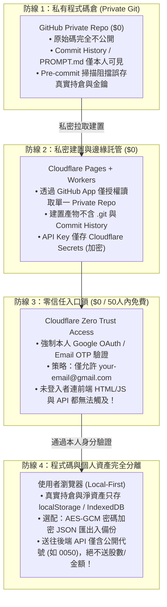

# 避免 GitHub 免費部屬公開持倉與 Commit History 之安全與隱私架構指南

- **撰寫日期**：2026-11-27 (+08:00)
- **問題背景**：先前使用 Claude 查核 GitHub 部屬時，指出「GitHub 免費版須將專案設為 Public」，擔憂導致**輸入儲存在網站的資產持倉**或 **Git Commit History（含專案紀錄與程式碼）**遭到公開外洩。
- **核心結論**：**完全可以 $0 免費徹底避免！** 關鍵在於釐清「GitHub Pages 限制」與「資料存放位置」兩個層面，並導入 **「Private Repo + Cloudflare Pages + Local-First 資料分離 + Cloudflare Zero Trust Access 登入牆」** 五層縱深防禦。
- **範圍聲明**：本文件為架構與安全防護研究（**尚未實作網頁程式**），同步產出網頁視覺版：[PRIVACY_AND_PRIVATE_REPO_DEPLOYMENT.html](./PRIVACY_AND_PRIVATE_REPO_DEPLOYMENT.html)。

---

## 一、先精準拆解 Claude 查核指出的兩大風險（事實核對）

| 風險來源 | Claude 的判斷是否正確？ | 真實運作機制與外洩條件 |
| :--- | :---: | :--- |
| **風險 1：Commit History / 原始碼公開** | **✅ 對「GitHub Pages 免費版」完全正確** | GitHub 個人免費帳號本來就可建立**無限個 Private 私有倉**；但 **GitHub Pages 免費版硬性規定 Repo 必須是 Public**（私有倉開 GitHub Pages 須付費升級 GitHub Pro $4/月）。一旦設為 Public，所有原始碼、`PROMPT.md`、Commit 紀錄與誤提交的設定檔全網皆可瀏覽。 |
| **風險 2：輸入儲存在網站的資產持倉外洩** | **⚠️ 取決於架構設計（錯誤設計才會外洩）** | **正確的網頁架構下，使用者在瀏覽器輸入的持倉永遠不會寫回 GitHub Repo！** 資產持倉外洩只會發生在三種錯誤做法：① 把真實持倉寫死在程式碼/JSON/Excel 中並 `git push`；② 存入無權限控管的公開資料庫；③ 個人專用後台網址無登入驗證而遭外人存取。 |

---

## 二、免費平台 Private Repo 支援度實測比較（2026）

你**完全不需要**為了免費部屬網頁而把 GitHub Repo 設成 Public：

| 部屬平台（免費方案） | 支援 **Private GitHub Repo**？ | 免費 GitHub Actions 排程（Private 倉） | 建置 / 流量免費額度 | 結論 |
| :--- | :---: | :---: | :--- | :--- |
| **🏆 Cloudflare Pages (Free)** | **✅ 100% 免費支援！** | 私有倉每月 **2,000 分鐘**（每日跑 1 次盤後預熱僅耗 ~25 分鐘/月，僅佔 **1.25%**！） | 500 次建置/月、**無限靜態流量**、支援 Workers 後端 | **🏆 最佳解**：Repo 永遠保持 Private，完全免公開 Commit History！ |
| **Vercel (Hobby Free)** | **✅ 100% 免費支援！** | 同上（2,000 分鐘/月） | 100 次部署/日、100 GB 流量/月（限非商用） | ✅ 可用（若純屬個人非商用專案）。 |
| **Cloudflare CLI 直傳 (`wrangler pages deploy`)** | **✅ 連 GitHub 都可不綁定！** | 若需排程可改用 CF Cron Triggers（5 個免費） | 同 Cloudflare Pages Free | ✅ 最高極致隱私：程式碼只留本機或私有 Git，不授權任何第三方讀 Repo。 |
| **GitHub Pages (Free)** | **❌ 不支援**（強制 Public，否則需付費 $4/月） | 公開倉無限分鐘 | 100 GB/月軟上限、無後端 Proxy | ❌ **直接淘汰**（正是 Claude 警告的根源）。 |

---

## 三、五層縱深防禦架構（$0 成本，徹底杜絕持倉與歷史紀錄外洩）

### 防線 1：GitHub Repo 永遠設為 `Private` + 棄用 GitHub Pages
- 建立 GitHub 儲存庫時直接設為 **`Private`**，改由 **Cloudflare Pages（Free）** 連結該私有倉（安裝 Cloudflare GitHub App 時，權限嚴格勾選 **`Only select repositories`**，僅授權這單一專案）。
- 私有倉每月仍有 **2,000 分鐘免費 GitHub Actions**；每日台/美股盤後各跑 1 分鐘排程，一個月僅耗 ~45 分鐘（不到 2.5%），完全不必為了「公開倉無限分鐘」而犧牲隱私。

### 防線 2：嚴格「程式碼與個人資產 100% 分離」（Zero Personal Data in Git）
- **鐵律**：Git 儲存庫內**永遠只放範例假資料（Dummy Data）或空白初始範本**，絕不把真實持倉股數、現金餘額、年齡或家庭收支寫死進任何 `.js`/`.json`/`.xlsx` 後 Commit。
- **前端 Local-First 儲存**：網頁上輸入的真實持倉僅存於你個人裝置的瀏覽器 `localStorage` / `IndexedDB`；網路封包（Network Tab）送往後端 API 時**只傳公開標的代號與查詢日期**（例如 `GET /api/quote/live?ticker=0050`），伺服器與 Cloudflare D1 **永遠不知道你持有幾股或有多少資產**。
- **跨裝置安全備份**：若需換電腦/手機同步，使用前端 Web Crypto API 產出 **AES-256-GCM 密碼加密之 `.enc.json` 備份檔**（或選配存回你自己的私有 Google Drive AppData），即使檔案遺失也無法破解。
- **防呆攔截**：於 `.gitignore` 排除 `*.local.json`、`my_portfolio.*`、`.env*`，並設定自動化掃描確保任何真實金鑰或個人檔案皆無法被 Commit。

### 防線 3：網站入口掛上免費「Cloudflare Zero Trust Access」登入牆（$0 支援 50 人）
- 若此網頁屬於個人或家庭專屬、不打算開放陌生人使用：
  1. 於 Cloudflare Zero Trust（Free 方案，**50 位使用者內永久免費、超限阻擋不扣款**）建立 Self-hosted Application 綁定你的網頁網域。
  2. 設定存取策略：`Include -> Emails -> 你的專屬 Email`（支援 Google 登入或一次性信箱驗證碼 OTP）。
  3. **防護效果**：所有流量在進入 Cloudflare Pages 與 Workers API 前就於邊緣節點攔截驗證——外人就算猜到網址，也**連 HTML/JS 畫面都看不到、更無法盜刷你的股價 API 配額**！

### 防線 4：就算堅持只用 GitHub Pages 免費版的「雙倉隔離」備案（次佳解）
- 若有特殊理由非使用 GitHub Pages 不可，避免外洩 Commit History 的標準做法為 **Dual-Repo（雙倉隔離）**：
  - `Repo A (Private)`：放完整開發原始碼、所有 Commit History、`PROMPT.md` 與設計文件。
  - `Repo B (Public)`：僅由 GitHub Actions 在編譯完成後，以 **Orphan Single Commit（覆寫式單一提交、無歷史紀錄）** 推送編譯打包後的靜態檔 `dist/`，且網頁內不含任何真實資產（採 `localStorage`）。
- **但仍強烈建議優先採用 Cloudflare Pages + Private Repo**：少維護一個倉庫、無須公開編譯檔、還能免費內建 Workers 解決 CORS 與 Zero Trust 登入牆！

### 防線 5：若「完全不想讓任何資料離開 Google 帳戶」的零外洩極致選項
- 若你對私有部署仍有顧慮，我們**已經建置完成的 Google Drive 版（Google 試算表 + 綁定 Apps Script）**本身就是最強的私人沙盒：檔案存在你自己的 Google Drive（設為「僅限本人」），沒有任何公開網址、也沒有公開 Git Repo 風險！

---

## 四、對齊 AI 六層驗證框架之隱私與零外洩檢核標準（`GEMINI.md` 規範 B）

| 階段 | 針對「防持倉與歷史外洩」的驗證重點 | 通過標準 | 具體驗證方法 |
| :--- | :--- | :--- | :--- |
| **1. 形式審查** | `.gitignore` 完整排除個人檔案與 `.env`、Repo 屬性為 `Private`、無硬編碼真實資產 | 100% 必要安全規範完整 | 檢查 GitHub Repo visibility API (`private: true`) 與 `.gitignore` 規則。 |
| **2. 功能驗證** | 未登入訪問遭 Zero Trust 攔截；登入後 LocalStorage 讀寫與加密 JSON 匯出入正常；API 僅接收公開代號 | 核心測試通過率 ≥95%（目標 100%） | 無痕視窗未登入測試（應回傳 Access 登入頁）；DevTools Network 驗證封包零個資欄位。 |
| **3. 品質評估** | 清楚區分「範例模式」與「個人私密模式」，介面明確標示「所有資產僅存本機瀏覽器」 | 審查評分 ≥4/5 | UX 隱私狀態提示檢核與備份還原演練。 |
| **4. 安全與治理** | **零 Commit History 外洩、零真實持倉入庫/入 Git、零金鑰外洩、GitHub App 最小授權單一 Repo** | **零 Critical / High 風險** | 執行 `gitleaks`/靜態掃描、檢核 Cloudflare Secrets 隔離、測試外部未授權請求全數 `401/403`。 |
| **5. 穩定性與效能** | Private Repo Actions 月消耗遠低於 2,000 分上限；Zero Trust 驗證不影響正常快取與 P95 延遲 | 成功率 ≥98%，P95 達 SLA | 監控 Actions 月用量 `<5%`、Cloudflare Analytics 驗證邊緣延遲 `<150ms`。 |
| **6. 實際成效** | 兼顧「隨時隨地開網頁試算」的便利性與「零資產曝光」的安心度 | 滿意度與安全信心達標 | 實際跨裝置加密匯出入測試與 4 週使用追蹤。 |

---

## 五、總結行動建議（目前仍保持「先不實作」與「先不 git push」）

1. **建立 GitHub 儲存庫時**：務必選擇 **`Private`（私有）**，**不要**開啟 GitHub Pages 免費版。
2. **未來若要建置免費網頁版**：採用 **`Private GitHub Repo` → `Cloudflare Pages (Free)` + `Cloudflare Workers / D1` + `Cloudflare Zero Trust Access (Free 50人)`**，搭配 **Local-First 持倉設計（不存 Git、不存公開資料庫）**，即可在 **$0 成本**下同時達成「功能 100% 完整」與「Commit History / 真實資產持倉 0% 外洩」。
3. **本專案現狀檢查**：目前 `BetaCalculator` 內所有範例數據均為虛擬測試數字（無真實個資），且嚴格依 `GEMINI.md` 規範 D 未執行任何 `git add/commit/push`。
