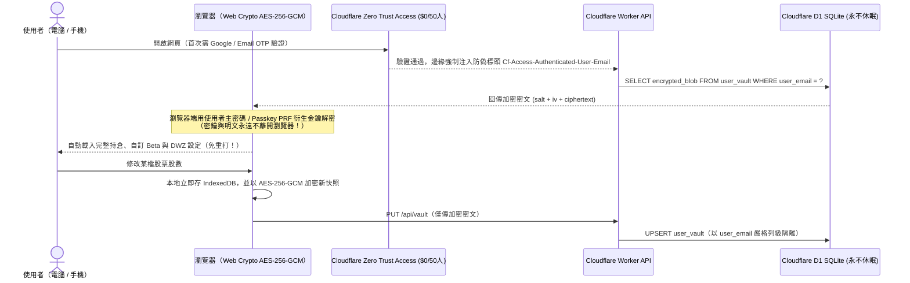
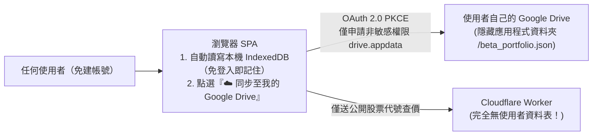

# 私密且免重複輸入之使用者資產持倉儲存架構研究

- **研究日期**：2026-11-27 (+08:00)
- **核心痛點**：解決「每次開啟網頁都要重新輸入股票持倉很不方便」，同時兼顧 **$0 免費成本**、**跨裝置自動同步** 與 **最高等級財務隱私（零知識 / 連開發者都看不到明文）**。
- **範圍聲明**：延續先前「先研究、不實作」指示，本文件僅進行技術方案評估與 AI 六層驗證設計，同步提供視覺版網頁報告：[PRIVATE_PORTFOLIO_STORAGE_RESEARCH.html](./PRIVATE_PORTFOLIO_STORAGE_RESEARCH.html)。

---

## 一、先釐清一個關鍵誤解：`localStorage` 其實不用每次重打

在規劃雲端儲存前，先區分「**同裝置免重打**」與「**跨裝置同步**」兩種需求：
1. **同裝置、同瀏覽器**：使用瀏覽器內建的 `localStorage` / `IndexedDB` 時，資料會**永久保留在你的裝置硬碟中**——關閉分頁、重開瀏覽器、甚至電腦重開機，下次打開網頁**所有持倉與設定都會自動恢復，不需要每次重打**。
2. **真正會遇到「需要重打」的情境**：
   - 電腦改完持倉，換成手機看時不同步；
   - 換瀏覽器（Chrome ↔ Safari）或換新手機；
   - 開啟無痕模式或誤清瀏覽器快取。

因此，最佳解法是採用 **「本機自動記憶（免登入零門檻）＋ 免費私密雲端同步（跨裝置自動帶入）」** 的雙層持久化設計！

---

## 二、五大免費私密儲存方案深度評比（2026）

| 方案 | 免費額度（$0） | 跨裝置自動同步？ | 開發者 / 平台能看到資產明文嗎？ | 需自建帳密系統？ | 核心優缺點與適用對象 |
| :--- | :--- | :---: | :---: | :---: | :--- |
| **🏆 方案 A：Google Drive `drive.appdata`（各自雲端隱藏夾）** | **永久 $0**（計入各使用者自己的 Google Drive 空間，JSON 僅數 KB） | **✅ 自動同步**（電腦/手機/各瀏覽器） | **❌ 完全看不到**（資料直連使用者自己的 Google Drive，不經你的後端！） | ❌ 不用（Google 一鍵登入） | **🌟 公開給大眾使用最推薦**：`drive.appdata` 屬 Google **非敏感權限 (Non-Sensitive)**，**免昂貴 CASA 資安審查**；開發者零資料庫費用、零個資保管責任。 |
| **🏆 方案 B：Cloudflare Zero Trust Access ＋ D1 ＋ 前端端對端加密 (E2EE)** | **永久 $0**（Access 50人免費；D1 5GB / 500萬讀/日、永不休眠） | **✅ 自動同步**（登入即自動解密載入） | **❌ 完全看不到**（瀏覽器先用 AES-256-GCM 加密再存 D1，DB 只有密文！） | ❌ 不用（CF Access 內建 Google / Email OTP） | **🌟 個人 / 親友小圈（≤50人）最推薦**：與先前 Cloudflare 架構無縫整合、零額外平台、順便防外人看網站。 |
| **方案 C：Google Drive `drive.file` 雙向連動既有試算表** | **永久 $0** | **✅ 自動同步**（網頁與 Google 試算表共用同一份資料！） | **❌ 完全看不到**（存在使用者個人 Google Drive） | ❌ 不用（Google 登入） | **🌟 試算表與網頁雙棲玩家**：同樣屬非敏感權限；你在 Google 試算表改股數，打開網頁自動同步！ |
| **方案 D：Firebase Auth ＋ Firestore (Spark Free) ＋ 前端 E2EE** | **永久 $0**（5萬 MAU、5萬讀/日、2萬寫/日、永不休眠） | **✅ 自動同步** | ⚠️ 預設雲端明文；**加上前端 E2EE 即零知識** | ⚠️ 內建 Firebase Auth（支援 Google/Apple/Email） | **公開多用戶產品備選**：若想支援非 Google 帳號（如 Apple ID、一般 Email）且不受 50 人限制。 |
| **方案 E：純本機 `IndexedDB` ＋ 一鍵密碼加密檔 (`.enc.json`) / URL 匯入** | **永久 $0** | ⚠️ 同裝置永久免重打；換裝置匯入 1 次即可 | **❌ 完全看不到**（100% 離線） | ❌ 完全免登入 | **極簡零帳號派**：最適合不想綁任何雲端帳號，且主要固定在 1–2 台裝置操作的使用者。 |

---

## 三、兩大首選架構詳細運作流程（零知識端對端隱私設計）

### 首選 1（個人 / 親友 ≤50 人專用）：Cloudflare Access ＋ D1 ＋ 前端 E2EE

**核心技術要點**：
1. **防偽身分隔離**：Worker **絕不信任前端傳來的 `user_email` 參數**，一律從 Cloudflare 邊緣層簽章驗證後的 `Cf-Access-Jwt-Assertion` / `Cf-Access-Authenticated-User-Email` 取得身分，強制執行 `WHERE user_email = ?` 列級隔離（防越權 IDOR 攻擊）。
2. **零知識端對端加密（Zero-Knowledge E2EE）**：
   - 使用瀏覽器原生 **Web Crypto API**（零第三方加密套件依賴）：
     - 金鑰衍生：`PBKDF2-SHA256`（600,000 次疊代）＋ 隨機 16-byte `salt`（或支援現代瀏覽器 **WebAuthn Passkey PRF** 指紋/FaceID 免記密碼解鎖！）。
     - 資料加密：`AES-256-GCM` ＋ 每次存檔重新生成 12-byte 隨機 `iv`（防重放與明文分析）。
   - **結果**：即便資料庫遭到外洩，攻擊者或管理員看到的也只有無意義亂碼，**連你有沒有買 0050 或有多少現金都無法得知**。
3. **極致流暢 UX（免每次打密碼）**：若使用者不介意 Trust Cloudflare 存取控制（本人限定登入牆），也可提供開關讓使用者自選「標準私密模式（登入即自動載入，無須第二組密碼）」或「最高零知識保險庫模式（加設主密碼 / Passkey 解鎖）」。

---

### 首選 2（公開分享給多人使用）：Google Drive `drive.appdata`（BYOS：Bring Your Own Storage）

**為什麼 `drive.appdata` 是公開免費工具的「神級解法」？**
1. **資料主權 100% 歸使用者**：每個人的持倉存在**他自己的 Google 帳號雲端硬碟隱藏空間**裡，你的系統根本不需要資料庫儲存使用者個資！
2. **官方列為「非敏感權限（Non-Sensitive Scope）」**：不需要做年費數千美元的 Google Restricted Scope / CASA 第三方資安審核；個人測試（100 人內）免審核立即可用，公開上線僅需一般品牌隱私權政策驗證。
3. **防誤刪且跨裝置自動同步**：`drive.appdata` 不會弄亂使用者的 Google Drive 根目錄檔案清單，但只要在手機或另一台電腦登入同一個 Google 帳號，1 秒自動同步全部持倉與設定！

---

## 四、對齊 AI 六層驗證框架之儲存層設計標準（`GEMINI.md` 規範 B）

| 階段 | 私密持倉儲存驗證重點 | 建議通過標準 | 具體檢核項目 |
| :--- | :--- | :--- | :--- |
| **1. 形式審查** | Vault JSON Schema 版本化（含 `schemaVersion`、`updatedAt` 衝突偵測）、D1 Table Index 與最小 OAuth Scope (`drive.appdata`) 聲明 | 100% 必要欄位完整 | Schema Validator（Zod / JSON Schema）、OAuth Scope 僅含非敏感權限。 |
| **2. 功能驗證** | 本機自動記憶、跨裝置雲端同步、樂觀鎖定衝突處理（手機與電腦同時編輯不互蓋）、AES-256-GCM 加解密往返一致、錯密碼明確提示 | 核心案例通過率 ≥95%（目標 100%） | 單元測試加密/解密往返、多裝置併發更新衝突測試、離線讀寫恢復測試。 |
| **3. 品質評估** | 首次開啟 0 門檻即用、同步狀態清晰（已同步 / 離線本機 / 加密鎖定）、明確提醒「忘記 E2EE 主密碼無法代為找回」 | 人工 / Judge ≥4/5 | 隱私 UX 審查、密碼遺失恢復流程（提供 Recovery Key 匯出）。 |
| **4. 安全與治理** | **防 IDOR 越權存取**（強制綁定已驗證 JWT Email）、**防明文外洩**（密文驗證、Network 封包零明文）、**防 XSS 竊取 LocalStorage**（嚴格 CSP 標頭） | **零 Critical / High 風險** | 模擬偽造 `Cf-Access-Authenticated-User-Email` 標頭與跨帳號存取測試（須全數 401/403）、驗證 D1 欄位不含可讀代號/金額明文。 |
| **5. 穩定性與效能** | 本地讀寫 `<10ms`、雲端同步防抖動（Debounce 2 秒避免高頻寫入耗額度）、加解密耗時 `<150ms`、離線容錯（網路斷線先存本機，復線自動補傳） | 成功率 ≥98%，P95 達 SLA | 模擬斷網/復網同步恢復率 100%、D1 寫入量監控（<1% 免費額度）。 |
| **6. 實際成效** | 徹底消除「重複輸入持倉」摩擦，量測回訪使用者開啟至看到最新淨資產與整體 Beta 之耗時 | A/B Test 達預定改善幅度 | 回訪用戶完成更新耗時從手動重打 ~5 分鐘降至 **< 5 秒（改善 >98%）**。 |

---

## 五、一句話選型結論（供您拍板）

- **👉 如果這網站主要是「你自己（或少數親友 ≤50 人）專用」**：
  選 **「本機 `IndexedDB` 自動記憶 ＋ Cloudflare Access 登入牆 ＋ Cloudflare D1 雲端儲存（選配前端 AES-256-GCM 零知識加密）」**——完全整合在同一套 Cloudflare 免費方案中，跨手機/電腦自動同步、外人打不開網站、而且 $0 永久免費！
- **👉 如果這網站未來想「公開給大家用（像 `alphalab.site/fire`）」**：
  選 **「免登入本機 `IndexedDB` 自動記住 ＋ 選配一鍵同步至使用者自己的 Google Drive (`drive.appdata`)」**——免建資料庫、免保管他人財務個資、跨裝置自動同步、同樣 $0 永久免費！
- **👉 兩者都想要（進階擴充）**：
  前端抽離統一的 `StorageAdapter` 介面（預設 `LocalIndexedDBAdapter`，自由切換 `CloudflareD1EncryptedAdapter` 或 `GoogleDriveAppDataAdapter`），隨時可無痛切換！
